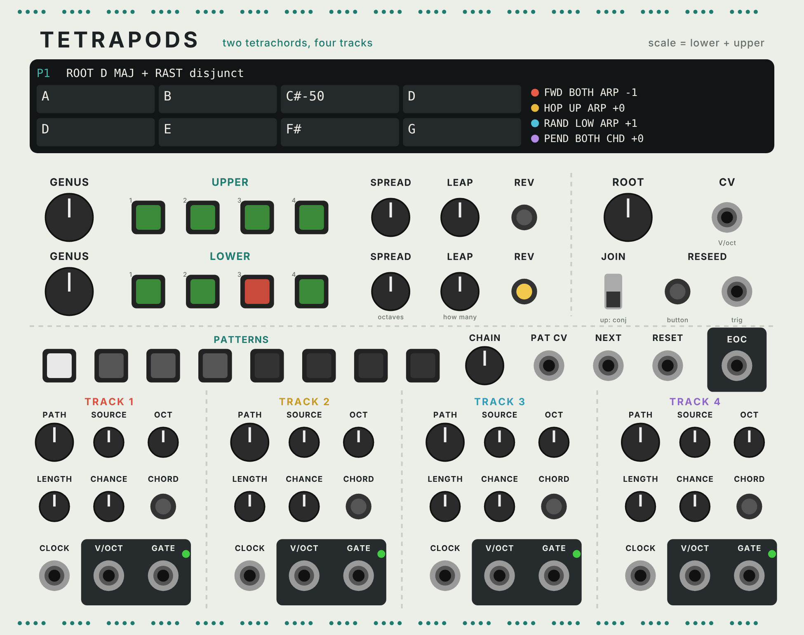

# Tetrapods

A VCV Rack 2 sequencer that builds its scale from two **tetrachords**: groups of four notes inside the frame of a fourth. It has four tracks that walk over those notes, and **every track has its own gate output**.

It is my own take on a two-tetrachord, four-track harmonic sequencer. It adds gate outs, polyphonic chord outputs, quarter-tone genera and gate chance.



## Quick start

1. Patch a clock (16ths, from Live via the disting NT, or VCV's Clocked) into **TRACK 1 CLOCK**. Tracks 2 to 4 use track 1's clock until you patch their own.
2. Patch **TRACK 1 V/OCT** and **GATE** into a voice. You now hear a major scale going up.
3. Turn the **UPPER GENUS** knob. The top half of the scale changes character: minor, Phrygian, Hijaz, Rast...
4. Tap a few note buttons to switch notes off. Green means on. They flash red when a track plays them.
5. Turn up **LEAP** on one row. Some notes now jump up by octaves, and **SPREAD** sets how far. Press **RESEED** for a different set of leaping notes.
6. Patch tracks 2 to 4 to other voices and give each a different **PATH** and **SOURCE**.

## The idea

A tetrachord is four notes spanning a fourth. Two of them make a scale:

- **Disjunct** (JOIN down): the upper tetrachord starts a fifth above the root. Major + major = the major scale. Minor + minor = Dorian. Phrygian + Phrygian = Phrygian.
- **Conjunct** (JOIN up): the upper starts on the lower one's top note, so they share it and the scale spans a minor seventh. This is how maqam and Byzantine scales stack, and it gives you 7 different pitches plus a doubled one.

Changing one tetrachord while the other stays put is a small, musical move. It changes the colour of half the scale, and the tracks keep playing their paths through it.

## Genera

| Genus | Steps (cents) | Notes on a C root |
|---|---|---|
| Major | 200, 200, 100 | C D E F |
| Minor | 200, 100, 200 | C D Eb F |
| Phrygian | 100, 200, 200 | C Db Eb F |
| Lydian | 200, 200, 200 (tritone frame) | C D E F# |
| Hijaz | 100, 300, 100 | C Db E F |
| Chromatic | 100, 100, 300 | C Db D F |
| Rast | 200, 150, 150 | C D E-half-flat F |
| Bayati | 150, 150, 200 | C D-half-flat Eb F |
| Saba | 150, 150, 100 (diminished fourth) | C D-half-flat Eb Fb |
| Enharmonic | 50, 50, 400 | C C-quarter-sharp Db F |

Rast, Bayati and Saba use quarter tones (V/oct is continuous, so they come out exactly). They sit well next to Zvuni's microtonal partner voice.

Some combinations to try: **Hijaz lower + Minor upper** (conjunct) is the Hijaz maqam colour. **Phrygian lower + Hijaz upper** gives a dark, Middle Eastern feel. **Major lower + Phrygian upper** is the Mixolydian b6 / "Hindu" scale.

## Controls

### Tetrachord rows (UPPER on top, LOWER below)

| Control | What it does |
|---|---|
| **GENUS** | Which of the 10 tetrachords this row uses |
| **1 to 4** | Switch each note on or off. Green = on, red flash = just played |
| **SPREAD** | How far a leaping note jumps: 0 to 3 octaves |
| **LEAP** | How many of the row's notes leap. Which notes leap, and how far, is set by the seed, so the same knob position always gives the same result until you press RESEED |
| **REV** | This row plays top to bottom |

### Scale

| Control | What it does |
|---|---|
| **ROOT** | C to B |
| **CV** | Transposes the root, V/oct. Rounded to semitones (turn that off in the right-click menu for microtonal shifts). Patch Hapax or Metropolix here for a progression. The new root takes effect on each track's next step, so changes land on the beat |
| **JOIN** | Down = disjunct (upper starts a fifth up), up = conjunct (upper starts on the fourth) |
| **RESEED** button and trigger | New leap pattern, new Random and Drunk paths |

### Patterns

8 pattern slots. Each one remembers the note on/off buttons, both genera, both REV buttons and JOIN. Whatever you change goes into the slot that is lit.

| Control | What it does |
|---|---|
| **1 to 8** | Pick a pattern. Dim lights show the chain |
| **CHAIN** | **NEXT** steps through patterns 1 to this number, then wraps |
| **PAT CV** | Picks the pattern directly: 0 V = 1, each 1.25 V up = the next one. Overrides the buttons and NEXT while patched |
| **NEXT** | Trigger: go to the next pattern in the chain |
| **RESET** | Trigger: the next clock starts every track's path from the top |
| **EOC** | Trigger each time track 1's path comes back to its start. Patch EOC into NEXT for a new pattern every cycle, or through a clock divider for every 4 cycles |

Right-click the module to **copy this pattern** to another slot, or **clear** it.

### Tracks

| Control | What it does |
|---|---|
| **PATH** | **Forward**, **Backward**, **Pendulum** (up and back), **Hopscotch** (back to the first note between each: 1 2 1 3 1 4), **Converge** (outside in: 1 4 2 3), **Random** (a random order that stays the same until RESEED), **Drunk** (a random walk, one note up or down each step) |
| **SOURCE** | Left = lower tetrachord only, middle = upper only, right = both (8 notes) |
| **OCT** | -2 to +2 octaves. Track 1 starts at -1 for a bass line |
| **LENGTH** | Gate length as a share of the time between clocks. Fully right = **tie**: the gate stays high, for legato |
| **CHANCE** | How likely each step is to fire a gate. The pitch still moves when the gate is skipped |
| **CHORD** | Off = arp, one note per clock. On = every note of the source at once, as a polyphonic V/oct and gate. The path then picks the inversion: step 2 moves the lowest note up an octave, step 3 the lowest two, and so on |
| **CLOCK** | One step per pulse. Unpatched = the clock of the track to the left |
| **V/OCT**, **GATE** | The outputs. Both go polyphonic in chord mode. The green light shows the gate |

### The display

The top line shows the pattern, root, both genera and the join. The 8 boxes are the scale, with the upper row on top. Each box shows the note name, with cents when it is a quarter tone, and **+1**, **+2** or **+3** when it leaps. The coloured dots show which note each track played last. On the right is a line per track: path, source, arp or chord, and octave.

## With your rig

1. **Detroit chord stabs.** Track 2 on CHORD, SOURCE upper, LENGTH short, clocked at quarters off a Pam's output. Track 1 FORWARD on the lower row at OCT -1 for bass. Hapax sends a slow sequence into ROOT CV: the stabs and bass move together while the paths keep running.
2. **Autechre-style mutation without chaos.** Track 3 RANDOM, track 4 DRUNK, CHANCE around 70%. Patch EOC through a divider into RESEED so the random paths change every 8 cycles, and turn LEAP up slowly as an arrangement move.
3. **Arrangement from patterns.** Set up patterns 1 to 4 as verse, lift, drop and break: same notes but different genera or REV. Set CHAIN to 4 and drive NEXT from a Live clip that sends a trigger every 16 bars through CV Tools and the disting NT. Or patch a slow stepped LFO into PAT CV.
4. **Bulgarian / maqam colours with Zvuni.** Lower BAYATI, upper RAST, conjunct. Track 1 V/OCT and GATE into Zvuni's MELODY and GATE, and turn Zvuni's CLING up so it leans onto the ringing notes.
5. **Polyrhythm from one scale.** Track 1 on 16ths, track 2 on dotted 8ths from Aksak or Seuperclidean, track 3 on HOPSCOTCH at triplets. The same 8 notes in three different time feels.

## Build it yourself

GitHub Actions builds the Mac Apple Silicon plugin on every push to `main` and puts it on the [latest release](https://github.com/hardyfinn/tetrapods/releases/tag/latest).

```sh
c++ -std=c++11 -O2 -o test/engine_test test/engine_test.cpp && test/engine_test   # engine tests
python3 res/make_panel.py                                                         # redraw the panel (needs fonttools)
make dist RACK_DIR=/path/to/Rack-SDK                                              # build the plugin
```

The engine (`src/TetraEngine.hpp`) has no VCV code in it, so the tests run on their own.
